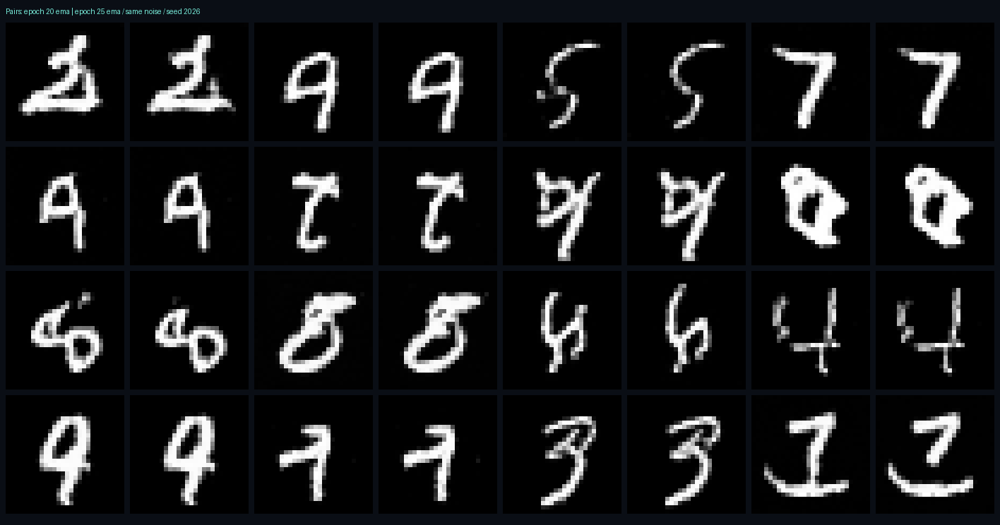

# 25epochへの追加学習（2026-10-21）

20epochの通常重み・optimizer・乱数状態・EMAから、MNIST training 60,000枚を5周追加学習した。
21〜25epochの学習率は2e-4から1e-4へ半減。batch128、CPU8threads、bf16 autocast、EMA0.995。
sample_path、TinyUNet、MSE、Euler法は変更していない。数字の指定はできない無条件生成のまま。

| モデル | 固定1024枚のFMテストMSE |
|---|---:|
| 20epoch EMA | 0.177981285 |
| 25epoch EMA | 0.176581170 |

20epoch比で予測誤差は0.79%低下。画像の認識率やFIDではなく、同じ時刻・ノイズで測った速度予測のMSE。
同じseed2026・50stepの生成64枚を確認。改善前後とも先頭16組を比較画像に掲載し、全64枚も残す。
線の接続や輪郭が変化したが、判別しにくい数字は残り、全画像の改善を保証しない。



[25epochの全64枚](images/generated-25-ema.png) · [20epochの全64枚](images/generated-20-ema.png)

## 実行手順

```sh
python -m ai.train --resume checkpoints/mnist20.pt --out checkpoints/mnist25.pt --epochs 25 --lr 0.0001 --batch-size 128 --threads 8 --bf16 --offline
python -m ai.evaluate --before checkpoints/mnist20.pt --after checkpoints/mnist25.pt --out quality/25
python -m ai.export --checkpoint checkpoints/mnist25.pt --seeds 42 43 44 --steps 20 50 100 --count 4 --out quality/demos25
```

学習時のテストデータ使用なし。アルゴリズムを変更せず学習率だけを調整したため、新しい生成式はない。
FMの学習式・Euler式とコードの対応は[MATH.md](MATH.md)を参照。

- 学習記録: [training-summary-25.json](training-summary-25.json)
- 評価: [evaluation-25.json](evaluation-25.json)
- 9本の全状態・全速度をモデルから再計算して照合: [demo-verification-25.json](demo-verification-25.json)
- checkpoint SHA256: `a2444c5ef8615b2fa1b0429ada397a8db79faa78eac5ccf2781a0e5573b230d5`
- 比較用20epoch SHA256: `3049e1ef5b6646c678700e17d7d839934e45856ee01af4bbe25669c412f90959`
- 実25epochモデルのAPI生成（4枚×50step）は保存デモと全状態・全速度が一致。転送込み0.786秒（環境依存の単発測定）。[結果](real-api-result-25.json)。
- Python17件・Node11件を実行し成功。ブラウザ描画・展示PCでの実操作・終日の耐久確認は今回も未実施。

古い20epochモデルとZIPは保持。新しい配布ZIPは25epochモデル・比較用20epochモデル・25epoch実生成デモ9本を収録する。
