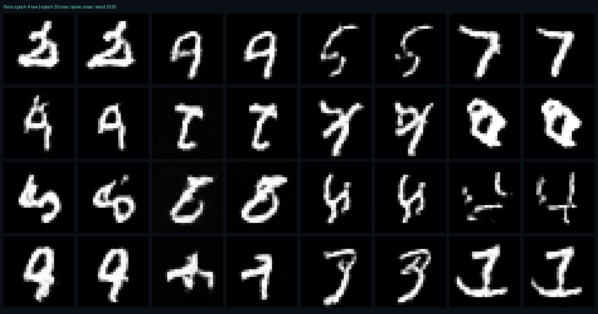

# 最新の配布モデル

25epochへ更新しました。[追加学習の比較・検証結果](QUALITY25.md)を参照。

以下は20epoch時点に記録した検証結果です。15分の耐久試験など、当時の測定条件を保持しています。

---

# 動作確認結果（2026-10-21）

## 現在の状態

**MNISTで20epochの実学習を完了。展示用には重み移動平均（EMA）を採用。**
元のsample_path・ResBlock・TinyUNetを保持し、MSE学習とEuler法を使う。
再生・停止・再開・時間スライダー・速度変更・複数画像・同じノイズでのステップ比較・速度場・変化量表示を実装。
保存した実生成デモの自動巡回と、新規推論なしの保存デモ比較も実装。

**実ブラウザの描画・実操作、展示PCでの物理的な回線切断、終日の耐久試験は未実施。**
クラウドブラウザのアクセス制限が継続しており、回避経路は使っていない。
下記のテスト結果を、これらの実機確認の代わりにしたという主張はしない。

## 学習条件と保存モデル

- MNIST training 60,000枚。全epochで60,000枚を使用。テスト画像による学習なし。
- 外部の学習済み重みは不使用。乱数初期化した自作TinyUNetから学習。
- base32、time_dim64、525,537パラメータ、seed42、batch128、AdamW lr2e−4、勾配norm上限1。
- GPUなし。1〜4epochはfloat32、5〜20epochはCPUのbf16 autocastで学習。
- 保存した重みとoptimizer状態、損失はfloat32。生成・書き出し・評価もfloat32。
- EMAは14〜20epochで使用。係数0.995、更新3283回。通常の学習重みも同じcheckpointに保存。
- checkpoint SHA256: `3049e1ef5b6646c678700e17d7d839934e45856ee01af4bbe25669c412f90959`。
- 比較用4epoch checkpoint SHA256: `b34b003f767cfcfe453c9a5e38b0b81e5907041123a192e0cff7aea34596d0d5`。
- 元ノートSHA256: `216cf3cede1aa57626c11e78e11c644c16e759687ab6c0e47d836a4467ac41b1`。

| epoch | 学習MSE（通常重み） |
|---|---|
| 1 | 0.335590 |
| 2 | 0.230518 |
| 3 | 0.215621 |
| 4 | 0.209041 |
| 5 | 0.204564 |
| 6 | 0.200477 |
| 7 | 0.198261 |
| 8 | 0.196740 |
| 9 | 0.194417 |
| 10 | 0.192906 |
| 11 | 0.192450 |
| 12 | 0.190439 |
| 13 | 0.189266 |
| 14 | 0.188297 |
| 15 | 0.187390 |
| 16 | 0.187223 |
| 17 | 0.186805 |
| 18 | 0.186912 |
| 19 | 0.185465 |
| 20 | 0.184944 |

**保存したモデルは実際に20epochまで学習したもの。** 詳細は `training-summary.json`。
元ノートの8epochモデルのcheckpointは受け取っていないため、それとの同条件比較はしていない。

## 同じ入力による評価

MNIST testの先頭1024枚に、seed2026で同じ時刻・ノイズを割り当て、Flow MatchingのMSEを測定。

| モデル | FMテストMSE | 4epoch比 |
|---|---:|---:|
| 4epoch・通常重み | 0.200323 | 基準 |
| 20epoch・通常重み | 0.181887 | 9.20%低下 |
| 20epoch・EMA | 0.177981 | 11.15%低下 |

**この数値は生成画像の正答率・FIDではない。** 学習で使わない画像での速度予測の誤差。
20epoch同士でもEMAの方が誤差が低く、固定64枚の画像も比較して展示用に採用した。
追加学習による線のつながりの改善は見られるが、線の途切れや判別しにくい形は残る。
全てが明瞭な数字になる保証はせず、FIDや分類器での認識率を測定したとは主張しない。

- [4epoch・64枚](images/generated-4-raw.png)
- [20epoch通常重み・64枚](images/generated-20-raw.png)
- [20epoch EMA・64枚](images/generated-20-ema.png)
- [同じノイズの対応比較](images/comparison.png)：固定64枚の先頭16組を、各組の左4epoch・右20epoch EMAで表示。

比較画像の全32タイルが、対応する元の生成画像と画素単位で一致することも確認した。
都合のよいサンプルだけを選んだ図ではない。全64枚も上記に残す。

評価の生データは `evaluation-raw.json` / `evaluation-ema.json`。

## 正しさ・API・操作ロジック

- Python: **17 tests passed**。元AIコードの保持、確率経路、backward、Euler更新、clamp非適用、seed再現、
  checkpoint復元・同時更新との競合、非同期API、cache上限・再利用、busy制御、エラー復旧を確認。
- PyTorchが存在しない条件を別プロセスで再現し、保存デモ再生が動くことも確認。
- 学習再開時の学習率維持・明示変更、EMAの加重平均・再開・raw/EMA読込選択も確認。
- Node: **11 tests passed**。保存経路からのスライダー、停止・再開・最終時刻、表示値変換、比較時刻同期、
  推論なしのデモ比較、自動展示、手動操作と自動読込の競合、raw/EMA混同の拒否を確認。
- 合計**28件**。Windows・LinuxのGitHub Actionsでも成功。
  [該当CI](https://github.com/ryotkkr-del/Flow-Matching/actions/runs/39552460563)
- Windowsの既定文字コードへの依存を取り除き、UTF-8読込を明示した。
- `node --check web/app.js` / Python compileall: PASS。
- UIロジックのテストはmock DOMによるもので、実ブラウザの描画確認ではない。

実20epoch EMAモデルで4枚×50stepをAPI生成し、51状態・50速度を照合: PASS。
保存デモとも全状態・全速度が一致。転送・JSON処理込み **1.45秒**。
この測定中は9本の軌道再計算も並行していた。環境依存の単発実測で、展示PCの速度保証ではない。
詳細は `real-api-result.json`。

## 保存デモの確認

seed42/43/44 × Euler20/50/100step × 各4枚、合計9本。
**全て今回の20epoch EMAモデルから生成した実軌道。** 保存状態・速度・時刻・raw/EMA情報を保持。
9本全ての展開、SHA256対応、Euler式、同じモデルからの全軌道再計算との一致を確認。
`demo-verification.json` にファイル別の結果と圧縮ファイルのhashを保存。
一時ファイルへの書き出しを完了してから置換し、不完全な保存データを読ませない。

## 連続運転の結果

ASGI TestClientで実4epochモデルを使い、905.8秒（約15分）実行。
20epochモデルは上記の単発API照合・デモ全件再計算で確認した。

| 項目 | 実測 |
|---|---:|
| 新規生成 | 90回 × 4枚 × 50step |
| cache hit確認 | 90回 |
| 失敗 | 0 |
| cache最大 | 95.86MiB / 上限96MiB |
| ジョブ履歴最大 | 64件 / 上限64件 |
| サーバープロセスの最大RSS | 423.2MiB |

上限到達後の古いcache削除と、バイト数の整合を確認。詳細は `soak-result.json`。
ブラウザのメモリではなくサーバープロセスの値。別プロセスの追加学習と並行する負荷条件だった。
15分を超える数時間〜終日の連続運転の確認は残る。

## 本番前に残る確認

1. 展示PCでstart.batを起動し、実際のブラウザで表示・再生・スライダー・比較・自動展示・ファイル選択を一通り確認。
2. 展示PCの回線を切り、モデル生成と保存デモが動くことを確認。外部API・CDN・外部フォントを使わない構成にはしている。
3. 会場の解像度・電源・画面スリープ設定で長時間動かす。実ブラウザを含む終日の耐久試験は未実施。
4. GPU/Colabの手順は用意したが、この実行ではGPUでの学習・Drive保存は未実施。

現在のStarletteはTestClientにhttpx非推奨の警告を1件出すが、全テストは成功。通常の展示起動ではTestClientは使わない。
